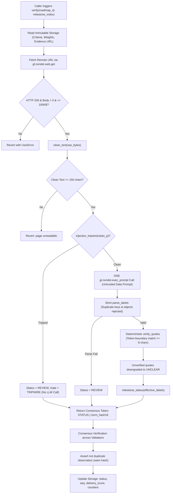

# System Architecture & Consensus Design

> **Contract**: `RoadmapLedger` & `TrancheGate`  
> **Network**: GenLayer Studionet (Chain ID 61999)  
> **Status**: Preview  

---

## 1. The Consensus Primitive

Roadmap Receipts employs the non-deterministic leader-validator pattern:
```python
gl.vm.run_nondet(leader_run, validator_run)
```

### The Consensus Token
The consensus token compared across all validator nodes is strictly defined as:
```
<STATUS>|<norm_hash16>
```
Where:
- `STATUS` is exactly one of four canonical states: `DELIVERED`, `PARTIAL`, `MISSED`, `REVIEW`.
- `norm_hash16` is the first 16 characters of the SHA-256 hash of the normalized cleaned evidence text:
  `norm_hash(cleaned_page)[:16]`

---

## 2. Why Validators Compare Exactly This (And What is Left Out)

### Why Compare `<STATUS>|<norm_hash16>`?
1. **Binding to the Evidence Read**:
   Including `norm_hash16` ensures that validators must have fetched and read the identical document state. If a remote web server serves different HTML or a CDN serves stale cache, validators will disagree on `norm_hash16` and reject consensus.
2. **Deterministic State Agreement**:
   Comparing the final derived `STATUS` ensures that the core business outcome (whether the milestone is delivered, partially delivered, missed, or under review) is identical across validators.

### What is Deliberately Left Out of Consensus?
- **Per-Criterion Quotes**: The extracted verbatim quotes are **not** part of the consensus token. Different LLM inference runs may select slightly different sentence boundaries (e.g. including or omitting an introductory clause). Forcing consensus on exact quote strings would cause artificial consensus failures.
- **Model Explanations or Free-Text Reasoning**: No reasoning strings are compared. The model output is constrained to a flat JSON structure of labels and quotes.
- **Secondary Metadata**: HTTP headers, timestamps, and formatting metadata are stripped before consensus.

### How Integrity is Preserved Deterministically
While quotes are leader-reported, every validator executes the exact same deterministic verification pipeline:
1. Validator fetches the page and verifies HTTP 200 and text bounds.
2. Validator runs the deterministic `clean_text` and `injection_tripwire`.
3. Validator invokes the model, strictly parses the output via `parse_labels`, runs `verify_quotes`, and computes `milestone_status`.
4. Validator computes its own `my_token = f"{my_status}|{my_norm_hash16}"` and asserts strict equality with `leader_data["consensus_token"]`.

If a malicious or malfunctioning leader fabricates quotes or returns an incorrect status, the validator's local derivation of `my_token` will mismatch, and the validator rejects the leader's submission.

---

## 3. The Defense-in-Depth Pipeline



---

## 4. Deterministic State Machines & Integer Math

### Milestone Status State Machine
Given effective labels:
- If `tripwire == True` -> `REVIEW`
- If any label is `UNCLEAR` -> `REVIEW`
- If all labels are `YES` -> `DELIVERED`
- If all labels are `NO` -> `MISSED`
- Otherwise (combination of YES, PARTIAL, NO without UNCLEAR) -> `PARTIAL`

### Delivery Score Formula (Integer Math Only)
Points per milestone status:
- `DELIVERED`: 100 points
- `PARTIAL`: 50 points
- `MISSED`: 0 points
- `REVIEW`: 0 points
- `PENDING`: 0 points

```
progress_pct = sum(milestone_weight * points) // sum(all_weights)
```
Integer division (`//`) is enforced. No floating-point values are computed or stored.

---

## 5. TrancheGate Cross-Contract Binding

`TrancheGate` provides milestone-gated credit releases bound strictly to roadmap integrity:
1. **Hash Pinning**: During `create_grant`, `TrancheGate` reads `milestones_hash` via synchronous view call to `RoadmapLedger.get_roadmap` and stores it immutably in the grant.
2. **Release Condition**: When `release(grant_id, tranche_index)` is invoked:
   - Synchronous view call to `RoadmapLedger.get_milestone_status`.
   - Asserts `curr_hash == stored_hash` (prevents releasing against altered roadmaps).
   - Asserts `status == "DELIVERED"`.
   - Moves tranche credits from escrow to recipient ledger balance.
3. **Reclaim Condition**: When `reclaim(grant_id, tranche_index)` is called by the funder:
   - Asserts `status == "MISSED"`.
   - Returns tranche credits from escrow to funder balance.
4. **Conservation Invariant**:
   `sum(balances) + total_escrow == total_minted` at every step.

---

## 6. Prompt Iteration Log

- **Iteration 0 (Current / Production)**:
  - Function: `build_prompt`
  - Source SHA256: `86875ca2e701277dc603ec588a7c572a1ede60bcdc9290ed592b10aa5b90e76a`
  - Design: Enforces UNTRUSTED DATA notice, flat list template `{"labels": [...], "quotes": [...]}`, explicit forbidden list (no objects, no indices, no prose, no code fences).
  - Status: Evaluated in Milestone 0 and empirical robustness harness.
